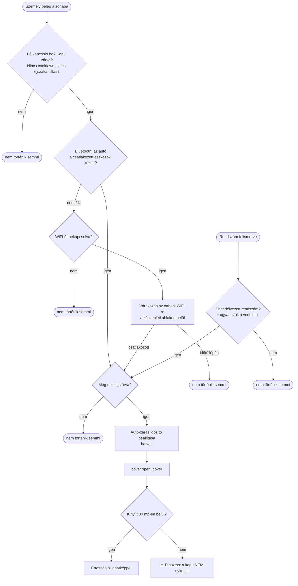

# Kapu automata nyitása érkezéskor – Home Assistant blueprint (magyar)

Fokozott biztonságú, **kétfaktoros** automata kapu- vagy garázsajtó-nyitás hazaérkezéskor. A kapu nem a GPS-zónába
lépésre nyílik, hanem csak akkor, ha egy **második, fizikai jel** is igazolja, hogy tényleg autóval érkezel:

1. **közeledés:** a személy belép a megadott zónába (Companion app, GPS);
2. **megerősítés:** a telefon **Bluetooth-on az autóhoz** kapcsolódik, és/vagy **az otthoni WiFi-re** csatlakozik.
   Ha mindkettő be van kapcsolva, amelyik előbb igazolja az érkezést, az nyit.

Ezen felül egy **független, harmadik út**: **rendszámfelismerés** (ALPR, pl. Frigate) – olyan vendégnek vagy
családtagnak, akinek nincs Home Assistant-alkalmazása. Minden úton ugyanazok a védelmek érvényesek: fő kapcsoló,
„csak zárt kapunál”, cooldown, éjszakai tiltás. Nyitás után a blueprint **megvárja, hogy a kapu tényleg kinyíljon**, és
csak utána küld értesítést, kamera-pillanatképpel.

> [!WARNING]
> A kapu mozgatása valós veszélyt jelenthet (gyerek, állat, autó a kapu útjában). A blueprint a kapumotor
> **saját biztonsági funkcióit** (fotocella, akadályérzékelés) **nem helyettesíti** – ezek legyenek bekapcsolva.
> Saját felelősségre, garancia nélkül (MIT licenc).

---

## Telepítés feltételei – mit kell előre telepíteni

| # | Mit | Honnan / hogyan | Kötelező? |
|---|---|---|---|
| 1 | **Home Assistant 2025.10 vagy újabb** | Beállítások → Rendszer → Frissítések | igen |
| 2 | **A kapu vagy garázsajtó integrációja**, amitől `cover` entitásként jelenik meg (pl. Shelly + sablon, ESPHome, a kapumotor gyári vagy felhős integrációja) | Beállítások → Eszközök és szolgáltatások (vagy HACS) | igen |
| 3 | **Home Assistant Companion app** a telefonon, helymeghatározással, `person` entitáshoz rendelve | App Store / Google Play; Beállítások → Emberek | igen (kivéve, ha csak rendszámfelismerés kell) |
| 4 | **Otthon zóna** (`zone.home`) – vagy egy saját zóna a kapu körül | Beállítások → Területek és zónák → Zónák | igen |
| 5 | **Kapcsoló segéd** a fő kapcsolóhoz, pl. „Kapu automata nyitás” (`input_boolean`) | Beállítások → Eszközök és szolgáltatások → Segédek → Segéd létrehozása → Kapcsoló | igen |
| 6 | A Companion app **Bluetooth-kapcsolat** szenzora (`sensor.<telefon>_bluetooth_connection`), **engedélyezve** | a telefon eszközoldalán a szenzor → ⚙ → Engedélyezés (lásd lent) | a Bluetooth-úthoz |
| 7 | A Companion app **WiFi BSSID** szenzora (`sensor.<telefon>_wi_fi_bssid`), **engedélyezve** | mint fent | a WiFi-úthoz |
| 8 | **Megbízható kapuhelyzet-érzékelő** (pl. Zigbee mágneses nyitásérzékelő) vagy küszöbös sablon (lásd lent) | az érzékelő integrációja | nem, de ajánlott, ha a kapumotor pozíciója pontatlan |
| 9 | **Kamera** a kapura (`camera` entitás) | a kamera integrációja | csak a képes értesítéshez |
| 10 | **Rendszámfelismerés**: [Frigate](https://frigate.video/) (beépített rendszámfelismeréssel) vagy más szenzor, amelynek az állapota a felismert rendszám | Frigate add-on / külön gép | csak az ALPR-úthoz |

> [!IMPORTANT]
> A Companion app Bluetooth- és WiFi-szenzora a Home Assistantban gyakran **alapból le van tiltva**. A telefonon a
> „Szenzorok kezelése” bekapcsolása **nem elég**: a Home Assistantban is engedélyezni kell (Beállítások → Eszközök és
> szolgáltatások → Mobile App → a telefon → a szenzor → ⚙ → **Engedélyezve**), majd az appban frissíteni a szenzorokat.

## Telepítés

[](https://my.home-assistant.io/redirect/blueprint_import/?blueprint_url=https%3A%2F%2Fgithub.com%2FGyuszko55%2Fha-kapu-hu%2Fblob%2Fmain%2Fblueprints%2Fautomation%2Fhu_kapu%2Fkapu_erkezes.yaml)

Vagy kézzel: Beállítások → Automatizálások és jelenetek → Blueprintek → **Blueprint importálása**, és illeszd be ezt a
címet: `https://github.com/Gyuszko55/ha-kapu-hu/blob/main/blueprints/automation/hu_kapu/kapu_erkezes.yaml`.

Utána: Automatizálások → **Új automatizálás → Blueprintből** → *Kapu/garázs automata nyitás érkezéskor*.
**Személyenként egy automatizálást** hozz létre (pl. „Kapu – Anna”, „Kapu – Béla”), saját telefonnal és autóval; a
közös fő kapcsolóval mind egyszerre kikapcsolható.

## Beállítások

| Szekció | Mező | Alapérték | Mire való |
|---|---|---|---|
| **Alap** | Személy | – | kinek az érkezését figyeljük |
| | Zóna | `zone.home` | a közeledés jele (belépés a zónába) |
| | Fő kapcsoló | – | `input_boolean`; kikapcsolva semmi nem nyit |
| | Kapu/garázsajtó | – | a nyitandó `cover` |
| **Kapuhelyzet** | Külön helyzet-érzékelő | üres = a kapu saját állapota | megbízhatóbb forrás a „zárva?” és „kinyílt?” ellenőrzéshez |
| | „Zárva” / „Nyitva” állapot | `closed` / `open` | be/ki érzékelőnél jellemzően `off` / `on` |
| **Bluetooth** | Bluetooth használata | ki | azonnali megerősítés a zónába lépéskor |
| | Bluetooth-kapcsolat szenzor | – | `sensor.<telefon>_bluetooth_connection` |
| | Az autó Bluetooth-nevének részlete | – | pl. „Toyota”, „Car Multimedia” – a csatlakozott eszközök között keressük |
| **WiFi** | WiFi használata | ki | késleltetett megerősítés: csatlakozás az otthoni hálózatra |
| | WiFi BSSID szenzor | – | `sensor.<telefon>_wi_fi_bssid` |
| | Otthoni WiFi BSSID | – | a router BSSID-je (a szenzor állapotából otthon kiolvasható) |
| | Készenléti ablak | 3 perc | a zónába lépés után ennyi ideig várunk a WiFi-csatlakozásra |
| **Rendszámfelismerés** | Rendszámfelismerés használata | ki | független út: engedélyezett rendszám → nyitás |
| | Felismert rendszám szenzor | – | pl. Frigate szenzor, állapota a rendszám |
| | Engedélyezett rendszám(ok) | – | vesszővel elválasztva, pl. `ABC-123, XYZ-987` |
| **Automatikus zárás** | Kapu auto-zárás `select` entitása / opció | – | ha a kapumotornak van saját auto-zárás időzítője, nyitás előtt beállítja (pl. `seconds_60`) |
| **Biztonság** | Cooldown | 120 mp | minimális idő két automatikus nyitás között |
| | Éjszakai tiltás | ki, 23:00–05:00 | ebben az időszakban nem nyit automatikusan |
| **Értesítés** | Notify szolgáltatás | – | pl. `notify.mobile_app_telefonom`; üresen nincs értesítés |
| | Kamera | – | pillanatkép az értesítéshez |
| | Késleltetés a fotó előtt | 3 mp | a kapu „nyitva” állapota után ennyit vár, hogy az autó is a képben legyen |

## Hogyan működik



- **Miért kell a második jel?** A zónába lépés önmagában gyalogos közeledésre, egy bekapcsolva elhagyott telefonra
  vagy pontatlan GPS-re is kioldana. A Bluetooth- vagy WiFi-jel azt igazolja, hogy a telefon tényleg az autóban van,
  illetve tényleg megérkezett.
- **Miért két út a megerősítésre?** Az autótól és a telefontól függ, melyik működik. Vezeték nélküli Android Autónál
  a telefon WiFi-je az autóhoz kapcsolódik, ezért az otthoni WiFi-re csak kiszállás után csatlakozik – túl későn.
  A Bluetooth viszont végig kapcsolva marad. Ha az autóban nincs Bluetooth, a WiFi-út a megoldás.
- **A Bluetooth feltétel, nem trigger.** Sok autóban a telefon már induláskor csatlakozik, és hazaérésig kapcsolva
  marad: a zónába lépéskor nincs „új csatlakozás” esemény. Ezért a blueprint a zónába lépéskor nézi meg, hogy az autó
  épp a csatlakozott eszközök között van-e.
- **Nyitás után ellenőriz.** Ha a kapu 30 másodpercen belül nem jelez „nyitva” állapotot (pl. a kapumotor
  felhőkapcsolata megszakadt), sikerüzenet helyett **riasztást** küld.

## Tapasztalatok és tippek

### Pontatlan kapumotor-pozíció → küszöbös sablon

Egyes (főleg felhős) kapumotor-integrációk zárt kapunál is 5–7%-os pozíciót és „open” állapotot jeleznek. Ilyenkor
a „kapu zárva?” előfeltétel nem teljesül, és **nem nyit**. Megoldás: egy sablon-cover, amely a pozíciót küszöbbel
értelmezi, és ezt add meg *Külön helyzet-érzékelő*ként (`closed` / `open`):

```yaml
# configuration.yaml (vagy egy packages/ fájl)
template:
  - cover:
      - name: "Kapu (megbízható helyzet)"
        unique_id: kapu_megbizhato_helyzet
        # zárt, ha a pozíció legfeljebb 10%; ha a kapumotor nem elérhető, a mágneses érzékelő dönt
        state: >
          
          {{ 'open' if p > 10 else 'closed' }}
          {{ 'open' if is_state('binary_sensor.kapu_nyitaserzekelo', 'on') else 'closed' }}
        open_cover:
          - action: cover.open_cover
            target: { entity_id: cover.kapu }
        close_cover:
          - action: cover.close_cover
            target: { entity_id: cover.kapu }
```

A **mágneses nyitásérzékelő sem hibátlan**: záráskor néha visszaugrik „nyitva”-ra, és úgy marad. A kettő ritkán
téved egyszerre, ezért a küszöbös pozíció és az érzékelő kombinációja a legmegbízhatóbb.

### Egyéb

- **Hálózati pingelés (nmap) nem jó jelenlétre:** a telefonok energiatakarékos WiFi-je miatt megbízhatatlan. A blueprint
  ezért a Companion app saját, eseményalapú szenzorait használja.
- **Gombos tartalék:** egy autóban tartott Bluetooth-gomb (pl. Shelly BLU Button) külön automatizálással önálló,
  harmadik nyitási út lehet ugyanezekkel a védelmekkel – a blueprint ezt nem tartalmazza.
- **Éjszakai tiltás:** minden útra vonatkozik, a rendszámfelismerésre is.
- **Ha a kapunak van régi, második vezérlése** (pl. egy korábbi relé), azt kösd le fizikailag is: két független vezérlés
  összezavarja a kapu állapotát.
- **Rendszámfelismerés:** a Frigate-et lehetőleg külön gépen futtasd (pl. egy Intel N100-as mini PC), ne a Home
  Assistant gépén. Élesítés előtt ellenőrizd, elég éles-e a kamera képe a rendszámhoz.

## Rokon megoldások

Az elkészítés előtt megnéztük a közösségi blueprinteket – pontos egyezés nem volt, ezekből merítettünk:

- **„V2 – Automatically unlock your door when getting in bluetooth range”** (HA Community Blueprints Exchange) – zóna +
  Bluetooth kombináció, várakozási ablak; ő a Bermuda integrációval háromszögel.
- **„Automatic Gate”** (zanix / etiennec78, Blueprint Hub) – kapura készült, több sofőrrel; Waze GPS/ETA-alapú.

## Licenc

MIT – lásd [LICENSE](LICENSE). A szerző a blueprintet egy valós, napi használatban lévő otthoni rendszerből
általánosította.
